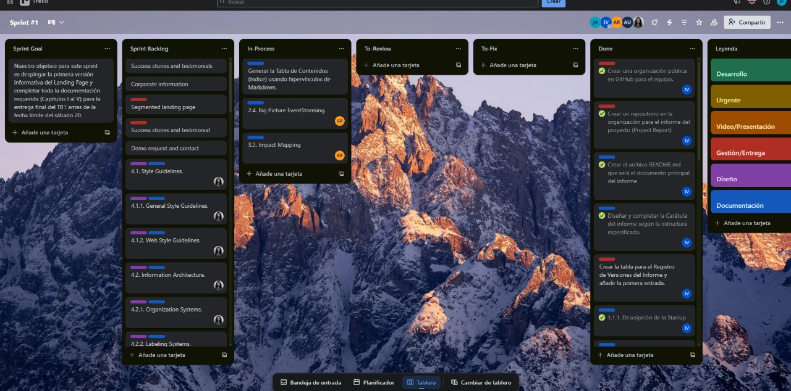
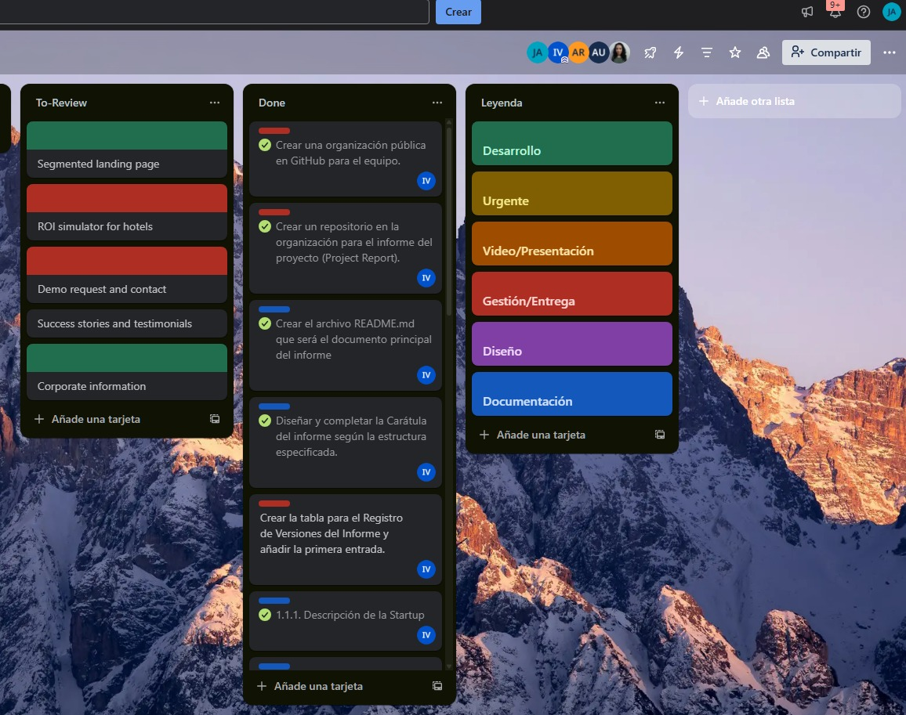

<div style="page-break-before: always;"></div>

# Capítulo VII: Product Implementation, Validation & Deployment

## 7.1. Software Configuration Management.

La gestión de configuración de Smart Stay define cómo se prepara el entorno de desarrollo, cómo se versiona el código, qué convenciones se siguen y cómo se construye, empaqueta y ejecuta la solución. El backend está compuesto por **siete microservicios en ASP.NET Core (.NET 9)**: IAM, Accommodations, Bookings, Payments, Profiles, Analytics y Concierge. Se ejecutan como contenedores Docker detrás de un gateway **Nginx**, con mensajería en **ActiveMQ** y persistencia en **MySQL**. Los clientes implementados son una **aplicación web en Vue 3** y una **aplicación móvil del huésped en React Native (Expo)**; ambas consumen únicamente el gateway. Estos clientes incluyen el visor de habitaciones en 3D y el recorrido 360°.

### 7.1.1. Software Development Environment Configuration.

**Project Management**

Para la gestión del proyecto se emplearon herramientas de comunicación, planificación y control de versiones. Se creó la organización **1ASI0728-9077-SmartStay-Movildev** en GitHub para centralizar los repositorios y coordinar el trabajo colaborativo.

| Actividad | Herramienta |
|---|---|
| Organización del trabajo y repositorios | GitHub (organización del equipo) |
| Reuniones | Discord |
| Comunicación | WhatsApp |
| Planificación y asignación de tareas | Trello |
| Gestión de Product Backlog y Sprint Backlog | Trello |
| Control de versiones | Git con GitFlow |

**Enlaces:** [GitHub](https://github.com/1ASI0728-9077-SmartStay-Movildev) · [Discord](https://discord.com/) · [Trello](https://trello.com/)

**Trello como soporte a Scrum.** El tablero usa las listas *Product Backlog* (User Stories priorizadas), *Sprint Backlog*, *To Do*, *In Process*, *To Review* y *Done*. Cada tarjeta incluye:

- Identificador de la User Story o Engineering Task (por ejemplo `US-24`, `UT-01`).
- Descripción, responsables, checklist de subtareas y fecha límite.
- Estimación de 4 a 8 horas por Engineering Task.
- Etiquetas: `Frontend`, `Backend`, `Documentation`, `Bug`, `Enhancement` y `High Priority`.
- Adjuntos (mockups, diagramas) y enlaces a los Pull Requests relacionados.

Flujo de trabajo del Sprint:

1. **Sprint Planning:** las User Stories pasan del Product Backlog al Sprint Backlog y se descomponen en Engineering Tasks con responsable y estimación.
2. **Desarrollo diario:** cada miembro mueve sus tareas de *To Do* a *In Process* y actualiza el avance con comentarios y checklists.
3. **Code Review:** al terminar, la tarea pasa a *To Review*. Otro miembro la valida y la mueve a *Done*, o la devuelve a *In Process* si requiere cambios.
4. **Sprint Review:** se verifica que todas las tareas del Sprint estén en *Done*, se documenta el resultado y se prepara el siguiente Sprint Backlog.

Métricas de seguimiento: burndown chart manual, velocity al cerrar cada Sprint y porcentaje de tareas completadas frente a las planificadas.


*Tablero Trello del Sprint 1 mostrando la organización de tareas*


*Tablero Trello del Sprint 2 con Engineering Tasks en progreso*

**Requirement Management**

Trello se usó para la gestión visual de tareas. **UXPressia** sirvió para elaborar *User Personas*, *Empathy Maps*, *Journey Maps* y *Lean UX Canvas*, y **Miro** para construir los escenarios *As-Is* y *To-Be*.

**Enlaces:** [Trello](https://trello.com/) · [UXPressia](https://uxpressia.com/) · [Miro](https://miro.com/es/)

**Product UX/UI Design**

El equipo utilizó **Figma** para crear *wireframes*, *mockups* y *prototipos interactivos*, validando las propuestas de diseño antes de su implementación, con principios de usabilidad y diseño centrado en el usuario.

**Enlace:** [Figma](https://www.figma.com/)

**Software Development**

| Componente | Tecnología | Herramienta |
|---|---|---|
| Aplicación web | Vue 3, JavaScript, Vite 8, Vue Router, Pinia, Axios, PrimeVue, vue-i18n, Chart.js y Three.js (visores 3D/360°) | Node.js (22.12+ o 20.19+) y npm |
| Aplicación móvil del huésped | React Native 0.88 con Expo SDK 58, React 19 y TypeScript (modo estricto); `react-native-webview` y `@react-native-community/netinfo` | Node.js, npm, Expo CLI, Expo Go y EAS Build |
| Visores 3D y 360° (móvil) | Three.js ejecutado dentro de una `WebView` (se carga desde el CDN jsDelivr) | `src/viewer/html.ts` |
| Backend (microservicios) | C# y ASP.NET Core (.NET 9), Entity Framework Core 9 con Pomelo MySQL, JWT Bearer, Polly y Swagger (Swashbuckle) | JetBrains Rider |
| Base de datos | MySQL alojada en filess.io (una sola base compartida; cada servicio usa sus propias tablas e historial de migraciones) | Contenedor `migrate` |
| Mensajería asíncrona | Apache ActiveMQ Classic 5.18 (cliente Apache.NMS.ActiveMQ) | Consola web (puerto 8161) |
| Gateway | Nginx 1.25 (reverse proxy) | Configuración en `deploy/nginx/nginx.conf` |
| Asistente inteligente | Servicio Concierge con la API de DeepSeek (opcional, con respaldo si no hay clave) | Variable `DEEPSEEK_API_KEY` |
| Contenedores | Docker y Docker Compose v2 | Docker Desktop |
| Autenticación de la API | JWT emitido por el servicio IAM | — |

Para ejecutar el backend no es necesario instalar .NET ni MySQL en el equipo, porque todo se compila dentro de Docker.

**Enlaces:** [Node.js](https://nodejs.org/) · [Vue](https://vuejs.org/) · [Vite](https://vite.dev/) · [Three.js](https://threejs.org/) · [React Native](https://reactnative.dev/) · [Expo](https://expo.dev/) · [JetBrains Rider](https://www.jetbrains.com/rider/) · [MySQL](https://www.mysql.com/) · [Docker](https://www.docker.com/) · [Nginx](https://nginx.org/) · [ActiveMQ](https://activemq.apache.org/)

**Software Documentation**

La documentación se redactó en formato **Markdown (.md)** dentro de los repositorios, siguiendo GitFlow. El informe del proyecto vive en su propio repositorio (`upc-pre-202610-1asi0728-9077-SmartStay-report`). Los endpoints de los microservicios se documentan con Swagger mediante las anotaciones `[SwaggerOperation]` y `[SwaggerResponse]`. Los diagramas de arquitectura se escriben en Structurizr DSL, PlantUML y DBML. Cada cliente documenta su ejecución en el `README.md` de su repositorio.

**Software Testing**

El cliente web usa el runner incluido en Node.js (`npm test`). Las pruebas de backend se ejecutan con el SDK de .NET y la prueba de humo se dirige al gateway de un entorno de demostración. La aplicación móvil dispone de la verificación de tipos de TypeScript (`npm run typecheck`) y se valida de forma manual en el emulador o en un dispositivo. Las comprobaciones de navegación de la web se realizan en el navegador, registrando la vista, el rol y el resultado observado.

**Software Deployment**

El backend se ejecuta con **Docker Compose** (detalle en 7.1.4). La web se compila a archivos estáticos con Vite. La aplicación móvil se ejecuta con **Expo** en un emulador de Android o en un dispositivo físico con Expo Go, y puede empaquetarse como APK con EAS Build.

---

### 7.1.2. Source Code Management.

**Repositorios del proyecto**

El proyecto está organizado en la **organización de GitHub `1ASI0728-9077-SmartStay-Movildev`**, donde cada módulo tiene su propio repositorio.

| Componente | Tecnología | Repositorio | Despliegue |
|---|---|---|---|
| Aplicación móvil (huésped) | React Native (Expo) y TypeScript | https://github.com/1ASI0728-9077-SmartStay-Movildev/frontend-movil | Expo Go / APK de pruebas con EAS Build |
| Backend (Web Services) | ASP.NET Core (.NET 9), microservicios | https://github.com/1ASI0728-9077-SmartStay-Movildev/backend | Docker Compose |
| Aplicación web | Vue 3 y Vite | https://github.com/1ASI0728-9077-SmartStay-Movildev/frontend-web | Compilación estática en `dist/` |
| Reporte | Markdown | https://github.com/1ASI0728-9077-SmartStay-Movildev/upc-pre-202610-1asi0728-9077-SmartStay-report | GitHub |
| Landing Page | HTML, CSS, JavaScript | https://github.com/Movil-dev-Aplicaciones-Moviles/landing-page | GitHub Actions / GitHub Pages |

Todos los repositorios siguen el modelo **GitFlow**. La rama principal del repositorio móvil es `master`; en los demás es `main`.

**Estructura de la aplicación web**

`src/` agrupa el código por dominio, entre ellos IAM, Accommodations, Bookings, Payments, Profiles, Analytics y Concierge. El código común reside en `src/shared/` y `src/router.js` centraliza rutas y control de acceso. Los visores 3D y 360° están en `src/accommodations/presentation/`. `package.json` define los scripts y `tests/integration.test.js` reúne las pruebas. El repositorio no incluye `package-lock.json`, por lo que la instalación se hace con `npm install`.

**Estructura de la aplicación móvil**

```text
frontend-movil/
├── App.tsx                       # Navegación inferior (Habitaciones / Mis reservas)
├── app.json                      # Configuración de Expo (paquete pe.smartstay.mobile)
├── package.json                  # Dependencias y scripts (start, android, typecheck)
├── tsconfig.json                 # TypeScript en modo estricto
└── src/
    ├── api/                      # Cliente HTTP (client.ts) y tipos del backend (types.ts)
    ├── components/               # SceneViewer, PanoramaViewer y componentes de UI
    ├── screens/                  # Login, Rooms, RoomDetail, Explore y Bookings
    ├── state/                    # Sesión del usuario (session.tsx)
    └── viewer/                   # HTML de los visores Three.js que corren en la WebView
```

**Estructura del repositorio backend**

```text
backend/
├── compose.microservices.yml     # Orquestación de todos los contenedores
├── backend-aw-smartstay.sln      # Solución .NET
├── .env.example                  # Plantilla de variables (el .env real no se versiona)
├── .github/workflows/            # Construcción y publicación de imágenes Docker
├── contracts/                    # Contratos HTTP y constantes compartidas
├── src/Services/                 # Un proyecto por microservicio, cada uno con su Dockerfile
│   ├── SmartStay.IAM/
│   ├── SmartStay.Accommodations/
│   ├── SmartStay.Bookings/
│   ├── SmartStay.Payments/
│   ├── SmartStay.Profiles/
│   ├── SmartStay.Analytics/
│   └── SmartStay.Concierge/
├── tests/                        # Siete proyectos de pruebas unitarias (uno por servicio)
├── tools/                        # Migración (SmartStay.Database), seed, smoke y verificación de fronteras
├── deploy/nginx/nginx.conf       # Configuración del gateway
├── client-templates/             # Plantillas de clientes (vue-room-tour y android-nearby)
└── docs/                         # Documentación, ADR, migración y MVP
```

**Flujo de trabajo GitFlow**

El flujo se basa en el modelo "A Successful Git Branching Model", con ramas específicas para cada funcionalidad o corrección.

**Diagrama del flujo GitFlow:**

```text
main (producción)
 |
 |---- release/0.2.1
 |          |
develop    |
 |         |
 |---- feature/deployment
 |         |
 |         (desarrollo)
 |         |
 |<-------- (merge mediante Pull Request)
 |
 |---- feature/3D-view
 |         |
 |         (desarrollo)
 |         |
 |<-------- (merge mediante Pull Request)
 |
 |---- hotfix/<descripción>   (prevista para correcciones críticas)
 |         |
 |<-------- (merge a develop)
 |         |
main <---- (merge a main)
```

**Proceso de trabajo:**

1. **Nuevas funcionalidades:** se crea `feature/<nombre>` desde `develop`, se desarrolla y prueba, y se fusiona a `develop` mediante Pull Request. La rama se elimina tras integrarse.
2. **Preparación de versiones:** se crea `release/<versión>` desde `develop`, se hacen ajustes finales, se fusiona a `main`, se etiqueta la versión y se sincroniza de vuelta con `develop`.
3. **Correcciones críticas:** se crea `hotfix/<descripción>` desde `main`, se corrige, se fusiona a `main` y `develop` y se etiqueta la nueva versión. Hasta ahora no ha sido necesario usar esta rama.

**Estructura de ramas:**

- **`main`:** código estable y listo para entrega. Recibe los merges de `release/*` y los Pull Requests desde `develop`.
- **`develop`:** rama de integración donde se combinan y prueban las funcionalidades antes de pasar a `main`.
- **`feature/*`:** una rama por funcionalidad, por ejemplo `feature/deployment` y `feature/fix-docker` (backend), `feature/menu` (web), `feature/3D-view` (móvil) y `feature/development-evidence` o `feature/sprint-planning-1` (reporte).
- **`release/*`:** por ejemplo `release/0.2.1` (backend y web) y `release/2.1`, `release/2.2` y `release/2.3` (reporte).
- **`hotfix/*`:** prevista por el modelo; todavía sin uso.

**Evidencia de aplicación de GitFlow:**

- **Backend:** ramas `main` y `develop`; `feature/fix-docker` (PR #2) y `feature/deployment` (PR #3) integradas a `develop`; PR #4 de `develop` a `main`; `release/0.2.1`; tags `0.1.2` y `0.2.1`.
- **Aplicación web:** ramas `main` y `develop`; `feature/menu` integrada mediante el PR #1; `release/0.2.1` y tag `0.2.1`.
- **Aplicación móvil:** ramas `master` y `develop`; `feature/3D-view` integrada mediante el PR #1 y `develop` a `master` mediante el PR #2.
- **Reporte:** ramas `main` y `develop`; ramas `feature/*` por capítulo o evidencia y publicaciones `release/2.1`, `release/2.2` y `release/2.3`.

Para los mensajes de commit, el equipo aplica Conventional Commits con la forma `tipo(alcance): descripción`, usando los tipos `feat`, `fix`, `docs`, `refactor` y `chore`. Por ejemplo, `feat(payments): add payment processing components with api integration for booking payments.` y `fix(accommodations): corrige spawn de la escena VR`. Las versiones usan `MAJOR.MINOR.PATCH` conforme a versionado semántico y se publican como tags sin prefijo `v`.

**Archivos excluidos del control de versiones**

El archivo `.env` contiene la cadena de conexión a MySQL y otros secretos, por lo que está en `.gitignore` y se excluye de los contextos Docker (`.dockerignore`). En el repositorio solo existe `.env.example` como plantilla. Los secretos no se suben a Git ni se muestran en capturas del informe. En el cliente web, los archivos `.env.development` y `.env.production` contienen únicamente el origen público del gateway.

**Integración continua con GitHub Actions**

El workflow `Docker` (`.github/workflows/docker-publish.yml`) del backend construye y publica las imágenes de los microservicios:

| Aspecto | Configuración |
|---|---|
| Disparadores | `push` a `main`, tags `v*.*.*`, `pull_request` hacia `main` y ejecución diaria programada (`cron: 27 3 * * *`) |
| Estrategia | Matriz de 7 servicios en paralelo: Accommodations, Analytics, Bookings, Concierge, IAM, Payments y Profiles |
| Construcción | Docker Buildx con el `Dockerfile` de cada servicio (`src/Services/SmartStay.<Servicio>/Dockerfile`) y caché de GitHub Actions |
| Registro | GitHub Container Registry (`ghcr.io`), solo cuando el evento no es un Pull Request |
| Firma | Las imágenes publicadas se firman con cosign |

En un Pull Request el workflow solo comprueba que las imágenes compilen, sin publicarlas. Nginx y ActiveMQ usan imágenes públicas y `migrate` se construye localmente, por lo que no forman parte de la matriz. Las aplicaciones web y móvil no tienen workflow de CI en sus repositorios.

**Verificaciones de calidad**

**Pruebas del backend.** Cada microservicio tiene su propio proyecto de pruebas en `tests/`, con **xUnit**, **FluentAssertions** y **Moq**; los seis proyectos que necesitan persistencia usan el proveedor *EF Core InMemory* (Concierge no usa base de datos). Se ejecutan con `dotnet test backend-aw-smartstay.sln -c Release`.

| Proyecto de pruebas | Archivos de prueba | Pruebas | Alcance |
|---|---|---:|---|
| `SmartStay.Accommodations.Tests` | `AccommodationsDomainAndBoundaryTests.cs`, `MigrationDiscoveryTests.cs`, `RoomLayoutValidatorTests.cs`, `RoomVrSceneAssemblerTests.cs` | 18 | Dominio y fronteras del servicio, descubrimiento de migraciones, validación de la distribución de habitaciones y armado de la escena 3D/VR |
| `SmartStay.Analytics.Tests` | `AnalyticsProjectionTests.cs` | 2 | Proyecciones autónomas de métricas |
| `SmartStay.Bookings.Tests` | `BookingConcurrencyAndLockTests.cs`, `BookingLifecycleTests.cs` | 9 | Concurrencia y bloqueos por noche, y ciclo de vida de la reserva |
| `SmartStay.Concierge.Tests` | `ConciergeRecommendationTests.cs` | 5 | Recomendaciones del asistente con precios y presupuesto validados por el servidor |
| `SmartStay.IAM.Tests` | `IamSecurityAndTokenTests.cs` | 3 | Seguridad y emisión de tokens |
| `SmartStay.Payments.Tests` | `PaymentIdempotencyAndOutboxTests.cs` | 6 | Idempotencia de pagos y patrón outbox |
| `SmartStay.Profiles.Tests` | `ProfileCreationAndIsolationTests.cs` | 3 | Creación de perfiles y aislamiento entre usuarios |
| **Total** | 11 archivos | **46** | |

**Pruebas de los clientes.** El cliente web ejecuta `npm test` (13 pruebas con el runner nativo de Node: sesión y JWT, fechas y límites de estadía, permisos, normalización de errores, cabeceras y clave de idempotencia, y ausencia de reintentos automáticos) y `npm run build`, que compila correctamente con un aviso por el tamaño del bundle principal. La aplicación móvil ejecuta `npm run typecheck` (`tsc --noEmit`).

**Otras verificaciones del backend.** `tools/check-boundaries.sh` comprueba que ningún servicio referencie a otro y `tools/smoke-mvp.sh` es la prueba de humo de 13 pasos descrita en 7.1.4. El despliegue y las operaciones de negocio con servicios reales requieren evidencia independiente. No se encontraron archivos de prueba `.feature` en los repositorios.

```bash
dotnet test backend-aw-smartstay.sln -c Release   # Pruebas unitarias del backend
bash tools/check-boundaries.sh                    # Verifica que ningún microservicio viole las fronteras arquitectónicas
bash tools/smoke-mvp.sh                           # Prueba de humo end-to-end de 13 pasos
npm test                                          # Pruebas del cliente web (en frontend-web)
npm run typecheck                                 # Verificación de tipos (en frontend-movil)
```

---

### 7.1.3. Source Code Style Guide & Conventions.

El equipo adopta convenciones de nomenclatura y guías de estilo estandarizadas para mantener la coherencia, legibilidad y escalabilidad del código. Variables, funciones, clases y archivos se nombran en **inglés**, según las convenciones de cada lenguaje.

**C# y ASP.NET Core (backend)**

Referencias: [C# Coding Conventions](https://learn.microsoft.com/en-us/dotnet/csharp/fundamentals/coding-style/coding-conventions) y [ASP.NET Core fundamentals](https://learn.microsoft.com/en-us/aspnet/core/fundamentals/).

| Elemento | Convención | Ejemplo |
|---|---|---|
| Clases, interfaces (prefijo `I`), métodos públicos | PascalCase | `RoomsController`, `IRoomQueryService` |
| Variables locales y parámetros | camelCase | `roomId`, `hotelQueryService` |
| Namespaces | `SmartStay.<Servicio>.<Capa>` | `SmartStay.Accommodations.Interfaces.REST` |
| Controladores | Sufijo `Controller` y ruta `api/v1/[controller]` | `HotelsController` → `/api/v1/hotels` |
| DTOs | `record` con sufijo `Resource` | `CreateHotelResource`, `HotelResource` |
| Comandos y consultas | Prefijo de intención | `CreateHotelCommand`, `GetHotelByIdQuery` |
| Conversión entre capas | Clases `...Assembler` | `HotelResourceFromEntityAssembler` |

Cada servicio se organiza por capas (`Domain`, `Application`, `Infrastructure` e `Interfaces`). Los controladores solo traducen HTTP a comandos y consultas, sin reglas de negocio. Cada endpoint declara su autorización por rol (`UserRoles.Guest`, `UserRoles.Admin`, `UserRoles.ChainAdmin`) y se documenta con Swagger.

**Reglas de arquitectura:**

- Cada servicio tiene su propio `DbContext` y sus propias tablas; ninguno accede al `DbContext` de otro.
- Los servicios se comunican por HTTP con contratos (`contracts/`) o por eventos en ActiveMQ.
- El código compartido se limita a contratos y constantes, nunca entidades ni repositorios.
- Los importes usan `decimal` y los precios los calcula el servidor, nunca el cliente.
- Las consultas SQL usan parámetros, sin concatenación de cadenas.
- El script `tools/check-boundaries.sh` verifica estas fronteras automáticamente.

**JavaScript y Vue (aplicación web)**

La aplicación web utiliza componentes de archivo único `.vue`, con `<script setup>` en las vistas revisadas. Los nombres de archivo usan minúsculas y guiones, como `booking-form.vue`. Las funciones y variables se nombran en camelCase. La presentación, las reglas del dominio y el acceso HTTP se ubican en carpetas diferenciadas (`presentation`, `domain`, `infrastructure` y `application`). Los textos de interfaz se centralizan en `src/locales/es.json` y `src/locales/en.json`. La comprobación disponible se ejecuta con `npm test` y `npm run build`.

**TypeScript y React Native (aplicación móvil)**

Referencias: [TypeScript Handbook](https://www.typescriptlang.org/docs/handbook/intro.html) y [React Native](https://reactnative.dev/docs/getting-started).

- **PascalCase** para componentes y pantallas, y para los archivos que los contienen (`RoomsScreen.tsx`, `SceneViewer.tsx`).
- **camelCase** para variables, funciones y parámetros; los tipos (`Room`, `Booking`, `RoomScene`) usan PascalCase.
- Componentes funcionales con hooks; la sesión del usuario se comparte mediante un contexto (`state/session.tsx`).
- Organización por carpetas de responsabilidad: `api`, `components`, `screens`, `state` y `viewer`.
- TypeScript en modo estricto (`"strict": true`), verificado con `npm run typecheck`.

**Buenas prácticas comunes**

- Nomenclatura en inglés.
- Principio **DRY** (*Don't Repeat Yourself*): evitar duplicación de código.
- Principio **KISS** (*Keep It Simple, Stupid*): priorizar soluciones simples y claras.
- Código con convenciones homogéneas entre los clientes y el backend; toda la información de negocio proviene del backend.
- Commits con Conventional Commits (`feat`, `fix`, `docs`, `refactor`, `chore`) y revisión de código mediante Pull Request.

---

### 7.1.4. Software Deployment Configuration.

El despliegue considera los aspectos que garantizan la disponibilidad y correcta operación de los componentes del sistema.

**Backend (Web Services)**

El backend se ejecuta con **Docker Compose** a partir del archivo `compose.microservices.yml`. Solo la base de datos MySQL está alojada de forma remota (filess.io); los demás componentes corren como contenedores.

```text
Clientes (app móvil React Native, web Vue)
        │
        ▼
Nginx Gateway (puerto 8080)  ← único puerto publicado
        │
        ├── /api/v1/authentication, /api/v1/users     → IAM
        ├── /api/v1/rooms, /api/v1/hotels, /tours     → Accommodations
        ├── /api/v1/bookings                          → Bookings
        ├── /api/v1/payments                          → Payments
        ├── /api/v1/profiles                          → Profiles
        ├── /api/v1/analytics                         → Analytics
        └── /api/v1/concierge                         → Concierge ──▶ API de DeepSeek

Bookings, Payments y Analytics  ⇄  ActiveMQ
Servicios con persistencia      ⇄  MySQL (filess.io)
```

**Contenedores definidos:**

| Servicio | Imagen o construcción | Función |
|---|---|---|
| `migrate` | `tools/SmartStay.Database/Dockerfile` | Crea o actualiza los esquemas y siembra datos; termina al finalizar |
| `activemq` | `apache/activemq-classic:5.18.3` | Broker de mensajería (puertos 61616 y 8161) con volumen persistente `activemq_data` |
| `gateway` | `nginx:1.25-alpine` | Punto de entrada único; monta `deploy/nginx/nginx.conf` |
| `iam`, `accommodations`, `bookings`, `payments`, `profiles`, `analytics`, `concierge` | `src/Services/SmartStay.<Servicio>/Dockerfile` | Microservicios .NET 9 en el puerto interno 8080 |

Los microservicios usan `expose` (accesibles solo dentro de la red de Docker); únicamente el gateway publica un puerto (`GATEWAY_PORT`, por defecto 8080) y ActiveMQ publica sus puertos 61616 y 8161 para el entorno local. ActiveMQ y los siete microservicios tienen `healthcheck`. Los servicios esperan a que `migrate` termine correctamente; Bookings, Payments y Analytics esperan además a que ActiveMQ esté saludable, y el gateway arranca al final, cuando los siete servicios han iniciado. Concierge no usa base de datos.

**Variables de configuración (`.env`):**

| Variable | Obligatoria | Descripción |
|---|---|---|
| `MYSQL_CONNECTION_STRING` | Sí | Cadena de conexión a filess.io (conservar `SslMode=Required;Pooling=false;`) |
| `JWT_SECRET`, `JWT_ISSUER`, `JWT_AUDIENCE`, `JWT_EXPIRATION_HOURS` | No | Tienen valor por defecto; el secreto debe cambiarse fuera de la demostración |
| `ACTIVEMQ_USER`, `ACTIVEMQ_PASSWORD`, `ACTIVEMQ_OPENWIRE_PORT`, `ACTIVEMQ_WEB_PORT` | No | Credenciales y puertos del broker |
| `GATEWAY_PORT` | No | Puerto del gateway (por defecto 8080) |
| `DEEPSEEK_API_KEY`, `DEEPSEEK_MODEL` | No | Clave y modelo de DeepSeek (por defecto `deepseek-chat`); sin clave, Concierge responde con un respaldo |

En una instalación nueva se copia `.env.example` a `.env` y se completa la cadena de conexión.

**Requisitos previos:** Docker Desktop con contenedores Linux y Docker Compose v2, una base MySQL en filess.io y conexión a Internet.

**Instalación inicial (base nueva):**

```powershell
docker compose -f compose.microservices.yml config --quiet
docker compose -f compose.microservices.yml build migrate
docker compose -f compose.microservices.yml run --rm migrate check
docker compose -f compose.microservices.yml run --rm migrate migrate
docker compose -f compose.microservices.yml run --rm migrate seed
docker compose -f compose.microservices.yml up --build -d
docker compose -f compose.microservices.yml restart gateway
docker compose -f compose.microservices.yml ps
```

Las migraciones se ejecutan una por servicio y de forma secuencial, nunca en paralelo. El comando `seed` agrega usuarios y datos de demostración sin borrar datos existentes; conviene ejecutarlo en una base destinada a la demo. El backend incluye la migración `20261109000000_AddRoomLayout` de Accommodations, que persiste la distribución de las habitaciones para el visor 3D.

**Arranque diario** (imágenes ya construidas y base inicializada):

```powershell
docker compose -f compose.microservices.yml up -d --no-deps --no-build --wait activemq iam accommodations bookings payments profiles analytics concierge
docker compose -f compose.microservices.yml up -d --no-deps --no-build gateway
docker compose -f compose.microservices.yml restart gateway
```

Se reinicia el gateway porque Nginx guarda en memoria las direcciones internas de los servicios, que cambian al recrear contenedores.

**Verificación y apagado:**

```powershell
Invoke-RestMethod 'http://localhost:8080/health'
Invoke-RestMethod 'http://localhost:8080/api/v1/rooms/search?district=Lima&guests=2'
docker compose -f compose.microservices.yml stop
```

Al detener los contenedores se conservan el volumen de ActiveMQ y los datos remotos de MySQL.

**Exposición pública para demostraciones.** Para que las aplicaciones cliente en otras redes accedan al backend se usa un túnel **Cloudflare Quick Tunnel** que apunta únicamente al gateway:

```powershell
& 'C:\Program Files (x86)\cloudflared\cloudflared.exe' tunnel --url http://localhost:8080
```

La dirección `https://<nombre-aleatorio>.trycloudflare.com` cambia en cada ejecución, por lo que se actualiza la URL base de las aplicaciones cliente. Nunca se exponen MySQL, ActiveMQ ni las APIs individuales.

**Validación del despliegue.** La prueba `bash tools/smoke-mvp.sh` ejecuta 13 pasos sobre el gateway:

| Paso | Verificación |
|---|---|
| 1 | Salud del API Gateway (`/health`) |
| 2 | Autenticación de `guest1`, `guest2` y de los administradores de ambos hoteles |
| 3 | Búsqueda en el catálogo de habitaciones |
| 4 | Manifiesto del Recorrido 360° (`/rooms/102/tour`) |
| 5 | Imagen panorámica del recorrido (`/tours/room-102/entry.jpg`) |
| 6 | Concierge con presupuesto suficiente: devuelve ofertas verificadas |
| 7 | Concierge con presupuesto excedido: no inventa habitaciones |
| 8 | Creación de una reserva de `guest1` en la habitación 102 |
| 9 | Consulta de las reservas propias (`/bookings/mine`) |
| 10 | Aislamiento: `guest2` no puede leer la reserva de `guest1` (HTTP 403) |
| 11 | Aislamiento: `guest2` no puede cancelar la reserva de `guest1` (HTTP 403) |
| 12 | Alcance por hotel: el administrador de Cusco no accede a la reserva de Grand Hotel Bolivar (HTTP 403) |
| 13 | Cancelación por el huésped propietario, con liberación del inventario |

| Usuario de prueba | Rol | Ámbito |
|---|---|---|
| `admin` | `admin` | Grand Hotel Bolivar (Lima) |
| `admin_cusco` | `admin` | Cusco Andean Lodge |
| `chain_admin` | `chain_admin` | Toda la cadena |
| `guest1`, `guest2` | `guest` | Huéspedes |

Las contraseñas de demostración se entregan fuera del informe.

**Web Application Deployment**

El cliente se prepara en un entorno Node compatible con el proyecto (Node 22.12+ o 20.19+) y se conecta al gateway mediante `VITE_MOVILDEV_API_URL`. El valor es el origen HTTP o HTTPS, sin el sufijo `/api/v1`, que el cliente añade. Los archivos de entorno de Vite contienen configuración pública y se incorporan al build. Las claves de DeepSeek y las credenciales de infraestructura corresponden al backend.

1. En la raíz del frontend, instalar dependencias con `npm install`.
2. Configurar el origen del gateway en `.env.development.local` y ejecutar `npm run dev`. Para una prueba local, usar `http://localhost:8080` si coincide con el puerto del gateway.
3. Ejecutar `npm test` y `npm run build`. Configurar el origen de producción antes de compilar.
4. Publicar el contenido de `dist/` en un alojamiento estático y configurar el retorno de `index.html` para las rutas de Vue Router, como `/catalog`. Si la web se sirve por HTTPS, usar también un gateway HTTPS.
5. Verificar el catálogo y las rutas privadas desde el origen publicado. Mientras se use el túnel temporal, mantener el gateway activo y reconstruir el frontend cuando cambie la URL.

El README del frontend registra pruebas unitarias y compilación, consultas públicas al gateway real y flujos de navegador con respuestas simuladas. El repositorio no incluye un workflow de publicación, por lo que el enlace de despliegue web definitivo queda por confirmar. La versión `0.2.1` está etiquetada en el repositorio.

**Mobile Application Deployment**

La aplicación móvil del huésped está desarrollada con **React Native y Expo** (TypeScript) en el repositorio `frontend-movil`. Consume la API a través del gateway y no guarda datos en el dispositivo: el token y la URL del servidor viven solo en memoria.

1. **Preparación del entorno:** instalar Node.js y ejecutar `npm install` y `npx expo install --fix`. Para probar en un emulador se usa un emulador de Android; para un dispositivo físico, la aplicación Expo Go.
2. **Ejecución:** `npx expo start`. La URL del backend se define de tres formas:
   - **Emulador Android:** la URL por defecto `http://10.0.2.2:8080` apunta al gateway de la PC anfitriona.
   - **Dispositivo con Expo Go (misma red WiFi):** en la pantalla de acceso, campo *Servidor*, se escribe `http://IP_DE_LA_PC:8080`.
   - **Túnel de demostración:** se escribe la URL `https` del túnel de Cloudflare en el mismo campo. La URL inicial también puede fijarse con la variable `EXPO_PUBLIC_API_URL`.
3. **APK de pruebas:** se genera con EAS Build (`npm i -g eas-cli` y `eas build -p android --profile preview`). El repositorio no incluye `eas.json`, por lo que el perfil `preview` debe configurarse antes del primer empaquetado.
4. **Configuración de red:** `app.json` habilita tráfico HTTP plano con `expo-build-properties` solo para pruebas locales; con un gateway público debe usarse HTTPS. El paquete Android es `pe.smartstay.mobile`.
5. **Servicios integrados:** consumo de las APIs REST del gateway: autenticación (`/api/v1/authentication/sign-in`), búsqueda de habitaciones (`/api/v1/rooms/search`), escena 3D (`/api/v1/rooms/{id}/vr`), recorrido 360° (`/api/v1/rooms/{id}/tour`) y reservas (`/api/v1/bookings`).

**Funcionalidades validadas en la aplicación del huésped.** La aplicación se valida con el usuario de prueba `guest1` y ofrece dos secciones en la navegación inferior: *Habitaciones* y *Mis reservas* (con cancelación). Al abrir una habitación, el botón *Explorar en 3D / 360°* muestra, por ejemplo, *Cusco Andean Lodge · #201* o *Grand Hotel Bolivar · #101* con dos modos:

- **Habitación 3D:** visor interactivo Three.js dentro de una `WebView` que representa de forma esquemática las paredes, el piso y las camas a partir de la distribución de la habitación. Muestra la superficie, el largo × ancho y la altura (42 m², 6 × 7 m y 3 m en la #201; 10.5 m², 3 × 3.5 m y 2.6 m en la #101).
- **Controles del visor:** el huésped arrastra para rotar y pellizca con dos dedos para acercar o desplazar. La casilla *Ver paredes* muestra u oculta las paredes y el botón *Restablecer vista* devuelve la cámara a su posición inicial.
- **Recorrido 360°:** visor panorámico de los nodos del recorrido, con controles de acercar, alejar y restablecer.
- **Paneles informativos:** área, tipo de piso (por ejemplo, *Porcelain* o *Wood*), camas (por ejemplo, *King, 1 plaza*) y capacidad en huéspedes, entregados por el backend junto con la escena.

Las reservas creadas desde la aplicación móvil quedan en estado `PendingPayment`, porque la aplicación no incluye el módulo de pago; la confirmación o expiración se gestiona desde el backend o la web.


*Visor de Habitación 3D de la habitación #201 del Cusco Andean Lodge (42 m²), con las paredes visibles, una cama King y dos camas de 1 plaza.*


*Visor de Habitación 3D de la habitación #101 del Grand Hotel Bolivar (10.5 m²), con una cama de 1 plaza y piso de madera.*

**Landing Page**

La Landing Page se despliega con **GitHub Actions** en GitHub Pages: https://movil-dev-aplicaciones-moviles.github.io/landing-page/. Su repositorio permanece en la organización anterior del equipo.

**Integración y despliegue continuo (CI/CD)**

- Todos los repositorios están conectados a **GitHub** (organización `1ASI0728-9077-SmartStay-Movildev`) y siguen GitFlow.
- En el backend, GitHub Actions construye las imágenes de los siete microservicios y las publica en `ghcr.io` al integrar en `main`. La publicación por tags aplica a los tags con el formato `v*.*.*`.
- En la Landing Page, GitHub Actions publica el sitio al fusionar en `main`.
- La aplicación web se compila con `npm run build` y la aplicación móvil se prueba con Expo y se empaqueta con EAS Build; ninguno de los dos tiene todavía un workflow de CI/CD.

**Limitaciones conocidas**

- IoT para domótica está definido como diseño en el capítulo IV. La integración con un gateway IoT y la prueba de comandos y telemetría quedan pendientes en la versión entregada. ActiveMQ documenta mensajería entre servicios.
- El código entregado no aporta evidencia de un componente Web3 desplegado. Los visores disponibles son una experiencia 3D/360° en la web y en la aplicación móvil.
- La aplicación móvil implementada es la del huésped: login, búsqueda, reservas y visores 3D/360°. La aplicación del staff, las notificaciones push (Firebase), los pagos y Concierge en móvil figuran en el diseño, pero no están en el código entregado. La plantilla Android de compartición Nearby está en `client-templates/android-nearby` del backend.
- El visor móvil carga Three.js desde un CDN, por lo que requiere conexión a Internet. La vista 3D es una representación esquemática basada en las dimensiones y la distribución de la habitación, no un modelo fotorrealista.
- Los tags publicados (`0.1.2` y `0.2.1`) no llevan el prefijo `v`, así que no activan el disparador `v*.*.*` del workflow; las imágenes se publican al integrar en `main`.
- La base MySQL gratuita de filess.io tiene límites de espacio y conexiones, por lo que se usan pocos datos, una instancia por API y `Pooling=false`.
- Una sola base y credenciales compartidas son una simplificación académica; en producción cada servicio tendría su propia base.
- El túnel de Cloudflare es temporal y adecuado para demostraciones, no para producción.
